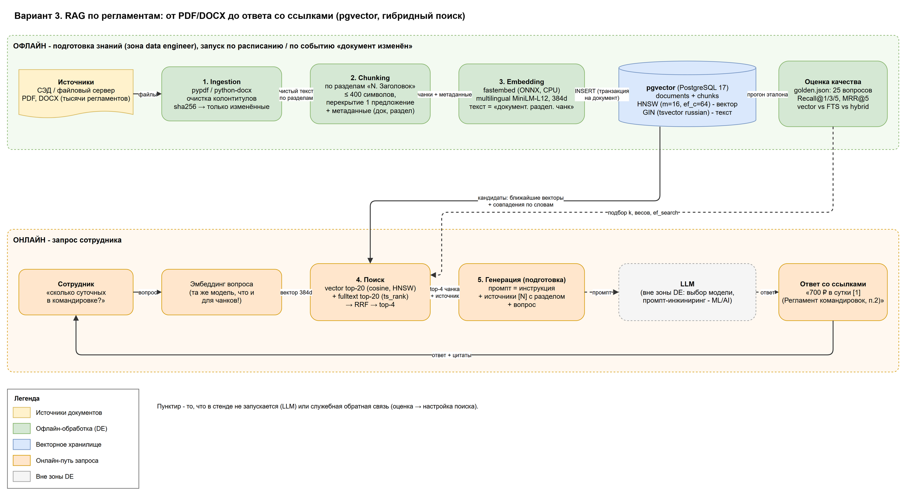

# RAG-сервис по корпоративным регламентам

Практическая работа №2, вариант 3 (RAG + векторная БД).

Пайплайн превращает регламенты в PDF и DOCX в базу знаний в PostgreSQL с pgvector и по вопросу сотрудника собирает промпт для LLM с 3–4 подходящими фрагментами и ссылками на документ и пункт. Сама LLM в работу не входит.

На эталоне из 25 вопросов гибридный поиск (вектор + полнотекст через RRF) даёт Recall@3 = 1.00, подробности в [разделе 5](#вопрос-3-как-оцениваю-качество-поиска).

## Как запустить

Понадобится Docker. При первом запуске скачивается модель эмбеддингов (около 255 МБ), она кэшируется в `models_cache/`.

1. Поднять базу:

   ```bash
   docker compose up -d vectordb
   ```

2. Сгенерировать корпус, загрузить его и посчитать метрики (`make_docs.py`, затем `ingest.py` и `eval.py`):

   ```bash
   docker compose up --build rag
   ```

3. Задать вопрос и получить готовый промпт:

   ```bash
   docker compose run --rm rag python ask.py "сколько суточных платят в командировке по России"
   ```

4. Повторная загрузка пропускает файлы, хэш которых не изменился:

   ```bash
   docker compose run --rm rag python ingest.py
   ```

База доступна снаружи на порту 54320 (`postgres` / `postgres`, БД `rag`).

## Что где лежит

- [`app/`](app) — код пайплайна:
  - `make_docs.py` генерирует 10 тестовых регламентов;
  - `chunking.py` извлекает текст из PDF/DOCX, чистит его и режет на чанки, `test_chunking.py` проверяет нарезку при сборке образа;
  - `ingest.py` считает эмбеддинги и пишет в pgvector;
  - `search.py` реализует векторный, полнотекстовый и гибридный поиск;
  - `eval.py` и `golden.json` — оценка на эталонных вопросах;
  - `ask.py` собирает промпт.
- [`db/init.sql`](db/init.sql) — схема, индексы HNSW и GIN.
- [`docs/`](docs) — сгенерированный корпус.
- [`results/`](results) — выводы прогона и метрики.
- `отчет.docx` — отчёт в Word.

## 1. Вариант и задача

| Поле | Значение |
|---|---|
| ФИО  | Белов Никита Дмитриевич|
| Тема | 3. RAG + векторная БД |
| Состав решения | пайплайн на Python (pypdf, python-docx, fastembed на ONNX) и PostgreSQL 17 с pgvector, индексы HNSW и GIN, гибридный поиск через RRF, оценка Recall@k и MRR |
| Данные, объём | 10 регламентов (5 PDF и 5 DOCX), 40 разделов, 40 чанков, эталон из 25 вопросов |

В компании накопились тысячи регламентов. Ответ на вопрос сотрудника в них обычно есть, но найти его вручную сложно. Задача состоит в том, чтобы сделать из этих файлов базу знаний: по вопросу, заданному обычными словами, система должна вернуть 3–4 подходящих фрагмента со ссылкой на документ и пункт. Эти фрагменты затем передаются в LLM. Генерацию ответа моделью мы в работу не включали, она заканчивается готовым промптом.

Для стенда мы подготовили 10 вымышленных регламентов: отпуска, командировки, пароли, удалённая работа, закупки, ИТ-инциденты, персональные данные, адаптация новых сотрудников, такси и связь, трудовой распорядок. Скрипт `make_docs.py` сохраняет их в PDF и DOCX. В PDF он добавляет колонтитул «Внутренний документ. Страница N», чтобы на этапе загрузки было что очищать.

## 2. Источники и способы сбора

| Источник | Тип | Способ сбора |
|---|---|---|
| регламенты в PDF (командировки, пароли, закупки, ПДн, такси) | документы PDF | пакетная загрузка: обход папки `/docs`, текст через `pypdf`, удаление колонтитулов |
| регламенты в DOCX (отпуска, удалёнка, инциденты, адаптация, распорядок) | документы DOCX | пакетная загрузка через `python-docx`, структура по стилям Title и Heading |
| изменения документов | инкремент | sha256 файла хранится в таблице `documents`. Если хэш совпал, файл пропускается, если нет, документ заменяется целиком в одной транзакции |
| вопросы сотрудников | онлайн-запрос | `ask.py "вопрос"`: эмбеддинг вопроса той же моделью, гибридный поиск, сборка промпта |

На практике документы будут приходить не из папки, а из СЭД, SharePoint или с файлового сервера, по расписанию или по событию об изменении. Проверка по хэшу при этом остаётся той же.

## 3. Архитектура



Схема выполнена в draw.io ([`architecture.drawio`](architecture.drawio)). В верхней части показана офлайн-подготовка базы знаний, за которую отвечает data engineer. В нижней показан путь запроса пользователя. Пунктиром отмечены LLM, которая на стенде не запускается, и обратная связь от оценки качества к настройке поиска.

На схеме задействованы темы курса: ingestion, chunking, embedding, векторная БД с индексом HNSW, полнотекстовый индекс, гибридный поиск и оценка качества поиска.

## 4. Docker: что поднялось

| Блок | Образ | Статус |
|---|---|---|
| Векторная БД | `pgvector/pgvector:pg17` | запущена, схема и индексы создаются при старте |
| Генерация корпуса | `regl-rag-app` на базе `python:3.11-slim` | выполнено, 10 файлов |
| Ingestion, chunking, embedding | тот же образ, `ingest.py` | выполнено, 40 чанков |
| Оценка качества | тот же образ, `eval.py` | выполнено, итог в [`results/eval.md`](results/eval.md) |
| Сборка промпта | тот же образ, `ask.py` | выполнено |
| LLM | — | не запускалась, генерация ответа не входит в задачи data engineer |

Трудности, с которыми мы столкнулись:

- модель эмбеддингов весит около 255 МБ и скачивается при первом запуске. Чтобы не загружать её каждый раз, мы смонтировали в контейнер папку `models_cache` с кэшем;
- fpdf2 выдавал ошибку «Not enough horizontal space»: после `multi_cell` курсор оставался у правого края страницы. Мы стали возвращать курсор к левому полю после каждой ячейки.

Контейнеры после прогона ([`results/docker_ps.txt`](results/docker_ps.txt)):

```text
NAME            IMAGE                    STATUS
regl-pgvector   pgvector/pgvector:pg17   Up 3 minutes (healthy)
regl-rag        regl-rag-app             Exited (0) 55 seconds ago
```

Вывод пайплайна ([`results/pipeline_output.txt`](results/pipeline_output.txt)):

```text
make_docs: created 9, total 10 files in /docs
  01_otpuska.docx: 5 sections -> 5 chunks
  02_komandirovki.pdf: 4 sections -> 4 chunks
  ...
  10_rasporyadok.docx: 4 sections -> 4 chunks
ingest: {'new_or_changed': 10, 'skipped_unchanged': 0, 'chunks': 40}; in db: 40 chunks, avg 190 chars, max 261
```

PostgreSQL с pgvector занимает около 56 МБ памяти, эмбеддинги считаются на CPU, GPU не нужен.

## 5. Описание: вопросы варианта

### Вопрос 1. Пять стадий: что происходит на каждой

| Стадия | Что делаем | Обоснование | Результат |
|---|---|---|---|
| 1. Ingestion | читаем PDF (`pypdf`) и DOCX (`python-docx`), убираем колонтитулы и пустые строки, склеиваем строки, разорванные вёрсткой PDF, считаем sha256 файла | строка вида «Страница 3» попала бы в каждый чанк и испортила бы и вектор, и полнотекстовый индекс. Хэш позволяет загружать только изменённые файлы | заголовок документа и список пар (раздел, текст) |
| 2. Chunking | делим текст по разделам вида «N. Заголовок». Раздел до 400 символов становится одним чанком, более длинный делится по предложениям с перекрытием в одно предложение. У каждого чанка сохраняем документ, раздел и номер | автор регламента уже разбил текст на смысловые пункты. Окно фиксированной длины разрезало бы пункт посередине | 40 чанков, в среднем 190 символов |
| 3. Embedding | `fastembed` (ONNX, CPU), модель `paraphrase-multilingual-MiniLM-L12-v2`, размерность 384. На вход модели подаём строку «Документ. Раздел. Текст» | модель понимает русский, работает без GPU и без torch. Название документа и раздела добавляет смысла коротким чанкам вроде «Пароль меняется каждые 90 дней» | вектор из 384 чисел на чанк |
| 4. Поиск | в pgvector два индекса: HNSW по косинусному расстоянию и GIN по `tsvector('russian')`. Каждым способом берём 20 кандидатов, объединяем через Reciprocal Rank Fusion и оставляем 4 лучших | векторный поиск находит близкие по смыслу формулировки («задержался допоздна» и «работа позже 22:00»), полнотекстовый находит точные слова и коды. RRF работает с рангами, потому что косинус и `ts_rank` несопоставимы по шкале | 4 чанка с источником |
| 5. Генерация | собираем промпт: инструкция отвечать только по источникам и ставить номер источника, пронумерованные фрагменты с документом и пунктом, сам вопрос | ссылки позволяют проверить ответ, а запрет отвечать без опоры на источники уменьшает выдуманные ответы | промпт, пример ниже |

Самый длинный раздел в нашем корпусе занимает 261 символ, поэтому все разделы стали отдельными чанками и деление по предложениям ни разу не сработало. Функцию деления мы проверяем тестом `test_chunking.py`, который выполняется при сборке образа. В настоящих регламентах длинные пункты встречаются часто, там она будет использоваться постоянно.

Пример промпта из `ask.py` ([`results/ask_example.txt`](results/ask_example.txt), тексты источников сокращены):

```text
Ты - помощник по внутренним регламентам компании. Отвечай только по источникам ниже.
Если ответа в источниках нет - так и скажи. После каждого факта ставь номер источника [N].

Источники:
[1] Регламент служебных командировок - 2. Суточные (02_komandirovki.pdf)
Суточные по России составляют 700 рублей за каждый день командировки, за рубежом 2500 рублей. ...
[2] Порядок компенсации расходов на такси и мобильную связь - 1. Такси (09_taxi_svyaz.pdf)
[3] Положение об ежегодных отпусках - 5. Отпуск без сохранения заработной платы (01_otpuska.docx)
[4] Регламент служебных командировок - 3. Проезд и проживание (02_komandirovki.pdf)

Вопрос: сколько суточных платят в командировке по России
Ответ:
```

Нужный пункт оказался на первом месте. Источники 2–4 совпадают с вопросом по словам «командировка» и «платят», но ответа в них нет. Как раз на такой случай в инструкции и стоит требование ссылаться на источник.

### Вопрос 2. Векторная БД, индексы и зачем гибридный поиск

Мы выбрали pgvector, а не отдельную векторную базу. Даже тысячи регламентов дают максимум сотни тысяч чанков, PostgreSQL с таким объёмом справляется. Документы, чанки, векторы и полнотекстовый индекс лежат в одной базе, поэтому документ заменяется одной транзакцией, метаданные фильтруются через `WHERE`, а резервное копирование и права доступа настраиваются как обычно. Специализированные решения вроде Qdrant или Milvus имеет смысл рассматривать при десятках миллионов векторов или жёстких требованиях к задержке.

Индекс выбирали между HNSW и IVFFlat:

| | HNSW | IVFFlat |
|---|---|---|
| Устройство | многослойный граф ближайших соседей | векторы разбиты на кластеры, поиск идёт по ближайшим |
| Обучение | не требуется, индекс строится даже на пустой таблице | нужны данные заранее, при росте таблицы индекс перестраивают |
| Полнота и скорость | полнота выше при той же скорости | строится быстрее, требует меньше памяти |
| Наш выбор | да, корпус постоянно пополняется | подходит для большого неизменного архива |

Параметры индекса: `m = 16` (число связей у вершины), `ef_construction = 64` (тщательность построения). При запросе выставляется `hnsw.ef_search = 40`: чем больше значение, тем полнее результат и тем медленнее поиск.

На 40 векторах полный перебор работает быстрее индекса, и планировщик PostgreSQL по умолчанию выбирает `Seq Scan`. С `SET enable_seqscan = off` в плане появляется `Index Scan using chunks_embedding_hnsw`, значит индекс построен и используется. Размеры: таблица чанков 40 КБ, HNSW 88 КБ, GIN 40 КБ.

Гибридный поиск понадобился потому, что векторный и полнотекстовый поиск ошибаются на разных вопросах. Это видно по результатам в следующем разделе.

### Вопрос 3. Как оцениваю качество поиска

Эталонный набор [`app/golden.json`](app/golden.json) состоит из 25 вопросов. Мы формулировали их своими словами, не копируя текст регламента: например, «Сколько можно потратить на гостиницу в Питере?», тогда как в документе написано «лимит на проживание 6000 рублей в Москве и Санкт-Петербурге». Для каждого вопроса указаны правильный документ и раздел.

Метрики:

- Recall@k — доля вопросов, для которых нужный раздел оказался среди первых k результатов. Для RAG она основная: если фрагмента нет в контексте, модель не сможет ответить правильно;
- MRR@5 — среднее значение 1/ранг первого правильного результата, показывает, насколько высоко он стоит.

| Режим | Recall@1 | Recall@3 | Recall@5 | MRR@5 |
|---|---|---|---|---|
| vector | 0.80 | 0.92 | 1.00 | 0.87 |
| fulltext | 0.64 | 0.76 | 0.80 | 0.70 |
| hybrid (RRF) | 0.76 | 1.00 | 1.00 | 0.85 |

Ниже вопросы, на которых хотя бы один режим поставил правильный раздел не первым ([`results/per_question.md`](results/per_question.md)). Число означает ранг, прочерк означает, что раздела нет в первой пятёрке.

| Вопрос | vector | fulltext | hybrid |
|---|---|---|---|
| Сколько дней длится основной отпуск? | 1 | 2 | 1 |
| До какого числа утверждают график отпусков? | 3 | 1 | 1 |
| Можно ли взять выходные на свадьбу без зарплаты? | 1 | — | 3 |
| Заболел в отпуске, что будет с отпуском? | 2 | 1 | 1 |
| Сколько можно потратить на гостиницу в Питере? | 1 | — | 3 |
| Меня заблокировало после неправильных вводов пароля, что делать? | 1 | — | 2 |
| Сколько дней в неделю можно работать из дома? | 5 | 3 | 1 |
| Компенсируют ли интернет при работе из дома? | 1 | — | 3 |
| В какой срок сообщить в Роскомнадзор об утечке? | 1 | 2 | 1 |
| Как оплачиваются переработки? | 4 | 4 | 1 |
| Во сколько можно приходить на работу? | 2 | — | 2 |

Векторный поиск справляется с перефразированием: по слову «свадьба» он находит раздел про регистрацию брака, по «Питеру» находит Санкт-Петербург. Полнотекстовый поиск на таких вопросах не находит ничего. Зато он сильнее там, где в вопросе есть точное слово из документа («график», «болезни»), а векторный поиск путает соседние разделы одного регламента.

Гибридный режим для всех 25 вопросов поднимает нужный раздел в первую тройку (Recall@3 = 1.00). На вопросах про работу из дома и про переработки ни один режим отдельно не ставил правильный раздел первым, а гибрид поставил.

По Recall@1 гибрид чуть хуже векторного поиска (0.76 и 0.80). В RRF оба списка имеют одинаковый вес, и если полнотекстовый поиск уверенно выдаёт не тот раздел, правильный опускается на 2–3 место. Поскольку в промпт уходят 4 чанка, для нас важнее Recall@3–4, и по нему гибрид лучший. Улучшить Recall@1 можно, увеличив вес векторного списка в RRF или добавив переранжирование кросс-энкодером.

В работающем сервисе к этим метрикам стоит добавить статистику по логам (доля вопросов без ответа, переходы по ссылкам на источники, оценки пользователей) и периодическую разметку выборки реальных вопросов. Проверять, опирается ли ответ модели на источники, должна ML-команда.

### Вопрос 4. Роль data engineer: что на мне, а что нет

| Задачи data engineer | Задачи других ролей |
|---|---|
| подключение источников, расписание, инкрементальная загрузка по хэшу | выбор и дообучение LLM |
| разбор форматов и очистка: колонтитулы, OCR сканов, таблицы | промпт-инжиниринг и тон ответа |
| стратегия чанкинга и метаданные: документ, раздел, дата, уровень доступа | оценка качества ответов модели |
| расчёт эмбеддингов, пересчёт при смене модели | интерфейс чат-бота |
| векторное хранилище, индексы, гибридный поиск | решение, отвечать ли на чувствительные вопросы |
| права доступа на уровне чанков, чтобы сотрудник не получил фрагмент закрытого для него регламента | |
| метрики поиска (Recall@k, MRR), контроль актуальности индекса | |

### Последовательность выполнения

| Этап | Назначение | Итог |
|---|---|---|
| 1. `make_docs.py` сохраняет корпус в PDF и DOCX | тестовые документы с колонтитулами | 10 файлов |
| 2. `ingest.py`: извлечение и очистка текста | текст, разбитый по разделам | ни одного чанка с колонтитулом |
| 3. Чанкинг по разделам | фрагменты с метаданными | 40 чанков, в среднем 190 символов |
| 4. Эмбеддинги и запись в pgvector, по транзакции на документ | векторное и полнотекстовое представление | 40 векторов, индексы HNSW и GIN |
| 5. Повторный запуск `ingest.py` | проверка инкрементальной загрузки | пропущены все 10 файлов, хэши не изменились |
| 6. `eval.py` на 25 вопросах | сравнение режимов поиска | у гибрида Recall@3 = 1.00 |
| 7. `ask.py` | вход для LLM | промпт с 4 источниками, нужный пункт первый |

## 6. Выводы

Качество RAG в основном зависит от того, как подготовлены данные. Очистка от колонтитулов, разбиение по структуре документа и название раздела в метаданных дают модели короткие законченные фрагменты с понятным источником, и ответ можно проверить.

Ни векторный, ни полнотекстовый поиск по отдельности не находят ответ на все вопросы: первый плохо работает с точными терминами, второй не распознаёт перефразирование. Объединение через RRF подняло Recall@3 до 1.00 при лучшем одиночном результате 0.92. Заметить это удалось только благодаря размеченному эталону, поэтому оценку на нём стоит запускать при каждом изменении пайплайна.

Для такого объёма pgvector полностью закрывает задачу, векторы, полнотекст и метаданные обновляются в одной транзакции. В рабочую версию мы бы добавили OCR для сканов, права доступа на уровне чанков, веса в RRF или переранжирование, пересчёт эмбеддингов при смене модели и мониторинг доли вопросов без ответа.

## Мой любимый десерт

Наполеон.
